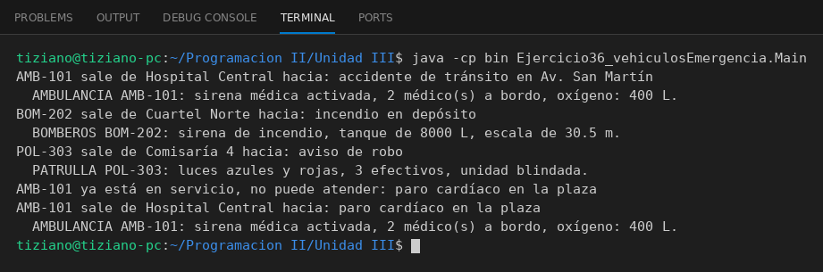

# VehiculoEmergencia

Programación II - Unidad 3 - Ejercicio 36

## Consigna
Modelar una jerarquía de clases con herencia: una clase base y subclases que reutilizan código con `super` y sobrescriben métodos. Vehículos de emergencia.

## Lógica
- `VehiculoEmergencia` con `despachar` (no permite dos servicios a la vez) y `activarAlerta()`.
- `Ambulancia`, `CamionBomberos` y `PatrullaPolicial` reescriben la alerta.
- `Main` simula despachos, incluyendo uno rechazado.

## Ejecución

